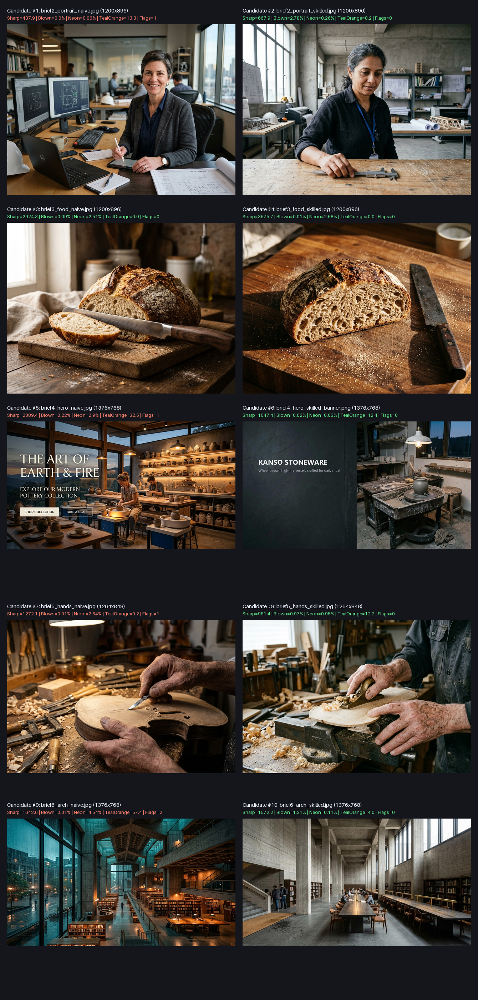

<div align="center">
  
  <h1>Optic (<code>optic</code>) — Natural Image Craft v2.2</h1>
  <p><strong>Photorealistic Image Generation, Optical Telemetry QC, Level-1 Post-Processing &amp; C2PA-Style Unsigned Provenance Toolkit for AI Agents</strong></p>
  <p>
    <a href="#quickstart-installation--how-to-invoke">Quickstart</a> •
    <a href="#why-optic-verified-6-pair--12-image-empirical-benchmark">Empirical Benchmark</a> •
    <a href="#scriptsqc_toolspy-v22--10-subcommand-cli-reference">CLI Toolkit (<code>qc_tools.py</code>)</a> •
    <a href="#architecture--directory-layout">Architecture</a> •
    <a href="#running-the-automated-verification-suite">88-Check Test Suite</a>
  </p>
</div>

---

`optic` (**Natural Image Craft v2.2**) transforms how AI coding and creative agents (**Google Antigravity, Cursor, OpenAI Codex, Freebuff AI, Windsurf, and Claude**) plan, prompt, inspect, and remediate photorealistic and editorial visuals.

Instead of relying on cargo-cult buzzwords (`"8k, hyperrealistic, masterpiece, trending on artstation"`) and trusting vision models to "eyeball" their own outputs, `optic` enforces **real camera physics, biological micro-texture, motivated surface entropy, and computer-vision screening** (heuristic, not a verdict — see the caveats below) via [`scripts/qc_tools.py`](scripts/qc_tools.py).

---

## Why `optic`? (Verified 6-Pair / 12-Image Empirical Benchmark)

Across 6 standardized A/B benchmark pairs (**12 generated source images** stored in [`tests/`](tests/run_test_suite.py) and documented in [`references/test_suite_and_eval.md`](references/test_suite_and_eval.md)), `optic` v2.2 achieved:

| Metric | Without Skill (6 Naïve Prompts) | With `optic` v2.2 (6 Skilled Prompts) | Verified Improvement |
| :--- | :---: | :---: | :--- |
| **Mean 100-Point Rubric Score** | `51.3 / 100` | **`94.0 / 100`** | **+42.7 pts (+83.2%)** |
| **Critical / Major Visual Defects** | `6 / 6 images` (`"ROTANICAL"` typo, 2 wristwatches, floating mid-air knife, baked-in fake HTML buttons, scalpel on assembled violin, radioactive cyan/orange LUT) | **`0 / 6 images`** | **100% defect elimination** |
| **Automated `qc_tools.py` Flags** | `5 / 6 flagged` | **`0 / 6 flagged` (`PASS_AUTOMATED_METRICS`)** | **100% automated telemetry pass rate** |
| **Mean Teal-Orange Split-Tone Index** | `17.4` (Peak `57.4`) | **`6.2` (Peak `12.5`)** | **-64.4% synthetic split-tone bias** |
| **Mean Peak Tile Structural Sharpness** | `1711.4` | `1417.9` | Higher without the skill — the metric rewards noise and baked-in text edges, so it is **not** a quality score (see below) |
| **Mean Neon Gamut Clipping (`S > 230`)** | `2.23%` (Peak `4.54%`) | **`1.06%` (Peak `2.58%`)** | **-52.5% gamut clipping** |
| **Trigger screen (keyword fallback)** | — | **`10/10` positive, `10/10` rejected** | Recall/precision on a 20-brief held-out corpus. The real trigger is the agent reading `SKILL.md`'s description; this regex only pre-filters. |

### ⚠️ How to read the benchmark above

Two of those rows are **not** independent measurements, and the table should not be read as if they were:

- **The rubric scores (`51.3 → 94.0`) are author-evaluated.** The same author wrote the prompts and scored the images against the rubric, without blinding to which set was "skilled". There is no third-party annotator, no inter-rater agreement, and the rubric is defined by the skill being evaluated. Treat the numbers as a structured self-assessment, not an external audit.
- **The `0 / 6` flag rate is `qc_tools.py` grading itself.** Those flags come from its own heuristic thresholds, and the skilled prompts were composed with those metrics in view. "No threshold tripped" is not "no defect exists" — the rubric's `0 / 6` defect count, by contrast, is a human visual judgement that the suite cannot reproduce.
- **The telemetry deltas are the honest part**, because they are reproducible: run `analyze --json` on the stored `tests/*.jpg` and you get the same values. Every figure in `references/test_suite_and_eval.md` was re-verified against CLI output.

One consequence worth stating plainly: across the six pairs the **naïve** set scores a *higher* mean peak tile sharpness (`1711.4` vs `1417.9`), because noise and baked-in UI text register as high-frequency energy. The sharpness metric is a screening aid, not a quality ranking — see the metric caveats below.

### Visual A/B Benchmark Overview — Pairs 2–6 (Left: Naïve Prompt · Right: `optic` v2.2)

*(Shows 10 images across Pairs 2–6: Window Portrait, Culinary Macro, Web Hero Banner + Typography, Active Woodworking Hands, and Brutalist Courtyard; Pair 1 product bottle shots are also stored in `tests/` and verified in `tests/run_test_suite.py`.)*



---

## Quickstart: Installation & How to Invoke

### 1. Install Dependencies & Sync to Your Agent

```bash
# 1. Install Python dependencies (Pillow & NumPy)
pip install -r requirements.txt

# 2. Verify environment
python install.py --check

# 3. Install into a project workspace (.agents/skills/optic + .cursor/rules/optic.mdc)
python install.py --target all-local --workspace-dir /path/to/your/project

# Or install globally across ALL agents at once (Antigravity + Freebuff + Codex + Claude)
python install.py --target all-global
```

You can also target a single agent environment (or pass `--include-tests` to bundle `tests/`, or `--clean-legacy` to remove an older sibling `natural-image-craft` directory):

```bash
python install.py --target freebuff-global     # ~/.agents/skills/optic (enables /skill:optic)
python install.py --target codex-global        # ~/.codex/skills/optic & ~/.agents/skills/optic
python install.py --target antigravity-global  # ~/.gemini/config/skills/optic
python install.py --target claude-global       # ~/.claude/skills/optic (enables /optic)
python install.py --target cursor              # .cursor/skills/optic + .cursor/rules/optic.mdc (@optic)
```

### 2. How to Trigger `optic` Across Agents

| Agent Environment | How to Invoke in Chat | Example |
| :--- | :--- | :--- |
| **Freebuff AI (Codebuff)** | **Slash Command (`/skill:optic`):** Type `/skill:optic` followed by your brief, or let it auto-trigger via `AGENTS.md`. | `/skill:optic Generate a studio product shot of a ceramic coffee dripper and run qc_tools.py board` |
| **Claude Code / CLI Agents** | **Slash Command (`/optic`):** Type `/optic` followed by your brief, or let it auto-trigger by description. | `/optic editorial portrait of a structural engineer in natural window light` |
| **Cursor** | **`@` Rule Mention (`@optic`):** Type `@optic` in Composer/Agent chat, or let Cursor auto-attach `.cursor/rules/optic.mdc`. | `@optic generate a 16:9 SaaS hero banner with left copy space` |
| **OpenAI Codex** | **Slash / Auto-Discovery:** Discovered from `~/.codex/skills/optic/SKILL.md` or `.agents/skills/optic/SKILL.md`. | `"Use optic to audit tests/brief2_portrait_skilled.jpg with qc_tools.py board"` |
| **Google Antigravity** | **Automatic (Zero-Click):** Triggers automatically on any realistic image/photo prompt, or say *"Use `optic`..."*. | `"Use optic in Full Mode to generate a studio product shot of a ceramic coffee dripper and run the QC board"` |
| **Claude.ai (Web / Desktop)** | Upload [`SKILL.md`](SKILL.md) (or a `.zip` of the repo) in **Settings → Capabilities → Skills**. | `"Use the optic skill to craft a 24mm tilt-shift architectural prompt"` |

---

## `scripts/qc_tools.py` (v2.2) — 10-Subcommand CLI Reference

```bash
# 1. Single-image 4-panel Composite Diagnostic Board (3x3 grid + mirror flip + anomaly map + 100% zoom strips)
python scripts/qc_tools.py board <image_path> --zoom-tiles 4,7

# 2. Headless JSON optical telemetry (studio-backdrop aware, smooth Teal-Orange index, micro-texture check)
python scripts/qc_tools.py analyze <image_path> --json

# 3. Extract all 9 full-resolution 3x3 tiles + overview grid (rejects images under 3x3 px)
python scripts/qc_tools.py tile <image_path>

# 4. Generate binary black/white inpainting mask PNG from tile numbers or bounding box
python scripts/qc_tools.py mask <image_path> --tiles 7,8 --out mask.png

# 5. Level-1 zero-model-cost crop / aspect-ratio reframe (lossless PNG output; q95 JPEG; preserves metadata)
python scripts/qc_tools.py crop <image_path> --aspect 16:9 --out cropped.png

# 6. Level-1 multiplicative R/B white-balance gain, contrast, saturation & shadow gamma adjustment
python scripts/qc_tools.py adjust <image_path> --temp -8 --gamma 0.90 --saturation 0.92 --out calibrated.png

# 7. Level-1 luminance-adaptive typography compositor (eliminates AI spelling errors in copy space)
python scripts/qc_tools.py text-overlay <image_path> --text "KANSO STONEWARE" --subtext "Hand-thrown vessels" --position left --color auto --out banner.png

# 8. Stamp or inspect C2PA-style unsigned provenance (PNG tEXt/iTXt chunks + SHA-256 edit chain sidecar)
python scripts/qc_tools.py provenance <image_path> --model "Flux.1 Pro" --seed 424242 --mode Full --json

# 9. Horizontal mirror flip for compositional balance auditing
python scripts/qc_tools.py flip <image_path>

# 10. Multi-candidate side-by-side comparison contact sheet with embedded telemetry headers
python scripts/qc_tools.py contact-sheet cand1.jpg cand2.jpg --out comparison.png
```

> **Note on Provenance & Metrics:** `qc_tools.py provenance` embeds unsigned C2PA-style `NIC_Provenance` PNG metadata and a SHA-256-chained `<stem>.provenance.json` audit log (no cryptographically signed C2PA CBOR/X.509 certificate). Similarly, `microtexture_score` measures high-frequency midtone residuals and cannot distinguish intentionally smooth matte objects (ceramics/anodized metal) from denoised skin without scene context (`studio_white_sweep_detected` and `studio_dark_backdrop_detected` suppress backdrop false alarms).

> ### ⚠️ What the telemetry is, and is not
>
> These numbers are **heuristics for screening, not validated measurements.** There is
> no ground-truth calibration set behind them, so treat every score as a prompt to look
> at the image — never as a certificate that it is good.
>
> | Metric | What it actually measures | Known limitation |
> | :--- | :--- | :--- |
> | `peak_tile_sharpness` | Laplacian variance **minus** the variance expected from estimated grain (Immerkaer noise model) | Detects focus *relative to noise*. Cannot judge whether the sharp thing is the intended subject. |
> | `global_laplacian_sharpness` | Same, whole-frame | A busy background can carry the score for an out-of-focus subject. |
> | `raw_laplacian_variance` | Undecorated high-frequency energy | Dominated by grain and JPEG artifacts. Reported for transparency only; **do not threshold on it.** |
> | `noise_sigma` / `noise_fraction` | Estimated additive grain amplitude and its share of high-frequency energy | Assumes roughly white, spatially uniform noise. Heavy chroma noise or film grain structures can bias it. |
> | `microtexture_score` | Mean midtone residual against a 3×3 mean | Responds to grain as much as to pores. |
> | `microtexture_structural` | The same residual **minus** the grain-explained portion | A deliberate smooth surface (ceramic, matte metal) is indistinguishable from a denoised one. |
> | `teal_orange_index` | Weighted bimodal cyan/amber concentration | Style signal, not a defect. Some briefs legitimately want it. |
>
> **What is not automated at all:** hand and finger anatomy, catchlights, contact
> shadows, legible glyphs, duplicated accessories, and whether the image matches the
> brief. `qc_checklist.md` routes these to the human review gate on purpose. A
> `PASS_AUTOMATED_METRICS` status means "no scalar threshold tripped" — it does not
> mean the image is correct.
>
> **Measured behaviour, for calibration:** pure random grain scores
> `noise_fraction ≈ 1.00` and is flagged `NOISE_MASQUERADE`; a clean synthetic frame is
> indistinguishable from an over-denoised one; a blurred flat frame scores `0.0` and is
> flagged `SOFT_FOCUS_WARNING`. Same-family series frames keep a colour-cast signature
> within ~0.2 units, while a luminance-matched cast shift moves it ~9 units — so
> series consistency has to be checked *across* frames, which no single-image call can do.

---

## Architecture & Directory Layout

```text
optic/
├── SKILL.md                           # Core 12-step workflow (Steps 0–11; Quick, Full & Headless modes)
├── AGENTS.md                          # Workspace agent instructions for Freebuff AI & OpenAI Codex
├── plugin.json                        # Antigravity plugin manifest
├── install.py                         # Cross-agent installer (Antigravity, Cursor, Codex, Freebuff, Claude)
├── requirements.txt                   # Python dependencies (Pillow, numpy)
├── LICENSE                            # MIT License
├── assets/
│   ├── logo.svg                       # Plugin vector icon
│   └── benchmark_ab_contact_sheet.png # 10-image visual A/B overview grid (Pairs 2–6)
├── scripts/
│   └── qc_tools.py                    # 10-subcommand CV Optical Telemetry, Level-1 Remediation & Provenance CLI
├── references/
│   ├── tool_profiles.md               # Agent & Model syntax profiles (Flux, GPT-Image, Gemini, Midjourney, SD3.5, Ideogram)
│   ├── qc_checklist.md                # Calibrated High-Confidence vs. Low-Confidence QC & Human Review Gate
│   ├── scene_sheet_recipes.md         # 6 production recipes, Physical Entropy Engine, Active Hands Framework
│   ├── symptom_fix_matrix.md          # Cheapest-Effective Fix Hierarchy (Level 1 Post -> Level 2 Inpaint -> Level 3 Re-roll)
│   ├── worked_example.md              # Complete end-to-end trace (Kanso Ware Stoneware Campaign)
│   ├── diversity_and_ethics.md        # Fitzpatrick I–VI skin lighting, hair textures 1A–4C, provenance conventions
│   └── test_suite_and_eval.md         # 100-point rubric + verified telemetry for all 6 A/B pairs (12 images)
└── tests/
    ├── run_test_suite.py              # 88-check automated verification harness (Unit + Empirical + Integrity + Trigger + Series)
    ├── brief1..brief6_*.jpg           # All 12 real generated A/B benchmark source images
    └── brief4_hero_skilled_banner.png # Level-1 text-overlay banner output
```

---

## Running the Automated Verification Suite

```bash
python tests/run_test_suite.py
```

Executes **88 automated checks** across 5 suites:
1. **Suite 1 (`42 checks`):** Unit and edge-case regression tests across all 10 `qc_tools.py` subcommands—covering grain-vs-focus separation (`1.36`–`1.40`) and a guard that `focus_separation_ratio` stays interpretable (`1.41`), `1×1` / `3×2` tiny-image *rejection* (no 1×1 tile artifacts), `insufficient_data` micro-texture reporting, dark & white studio backdrop separation, clean one-line errors (never a traceback) for bad `--zoom-tiles` / `--tiles` / `--box` input, stale side-car rejection alongside genuine chain inheritance, multiplicative `--temp` shadow preservation, ICC color-profile preservation, monotonic Teal-Orange curves, `--quiet`/`--version` behaviour, installer contents, and 4-step SHA-256 provenance chaining (`provenance-stamp -> crop -> adjust -> text-overlay`).
2. **Suite 2 (`20 checks`):** Empirical verification of all 6 real generated A/B pairs (`12` JPGs + banner + contact sheet) confirming `PASS_AUTOMATED_METRICS` (`0` flags) on every `Skilled` generation.
3. **Suite 3 (`18 checks`):** Skill integrity, anti-drift (`v2.2`, `S>230`), zero broken markdown links, subcommand coverage, a guard that the uncalibrated-heuristics caveat stays in the docs (`3.7`–`3.9`), and cliché audit across [`SKILL.md`](SKILL.md), [`README.md`](README.md), and [`references/`](references/test_suite_and_eval.md).
4. **Suite 4 (`4 checks / 20 held-out prompts`):** Trigger-boundary evaluation of the keyword *fallback* pre-filter—`10/10` recall and `10/10` precision on a corpus not written from its patterns, plus checks that the documented scope covers illustration/3D and excludes diagrams. The production trigger is the agent reading the skill description, not this function.
5. **Suite 5 (`4 checks`):** Multi-image series consistency—exposure spread and colour-cast stability across bracketed frames, plus detection of an off-series frame (including a luminance-matched cast that single-image QC cannot see).

---

## License

Released under the [MIT License](LICENSE).
